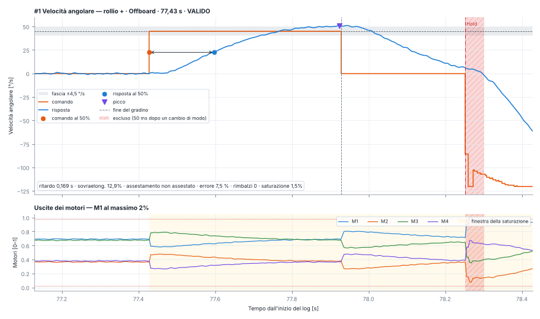
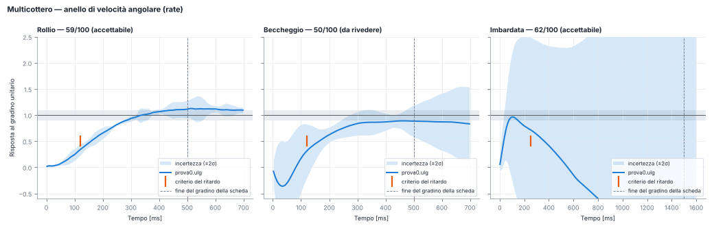

# Flight Analyzer

**Analisi dei log di volo PX4 (`.ulg`) e valutazione oggettiva dei PID** — Team Zefiro, Politecnico di Torino,
sezione Meccanica del volo.

Flight Analyzer è un'applicazione desktop che riprende le viste di [PX4 Flight Review](https://review.px4.io) in un
programma locale, con grafici sincronizzati, e aggiunge quello che a Flight Review manca per tarare un velivolo:

- **un punteggio 0–100 dei controllori** (velocità angolare e assetto, multicottero e ala fissa) con incertezza,
  margini di stabilità, diagnosi in testo e confronto tra tarature diverse;
- **la misura diretta delle prove a gradino**: ogni gradino trovato nel log, misurato rispetto al comando registrato e
  giudicato con i criteri della scheda di taratura del Vespa, con l'esito «tarato / non tarato»;
- **report PDF o HTML** che contengono anche i parametri di valutazione usati.

Pensata per PX4 v1.17 e per i VTOL (il Vespa è un tiltrotor): separa da sola multicottero, ala fissa e transizioni.
Interfaccia in italiano o in inglese, tema chiaro o scuro.



---

## Scaricare e installare

Non serve Python. Nella pagina **[Releases](../../releases/latest)** ci sono, per ogni versione:

| File | Cosa fa |
|---|---|
| `FlightAnalyzer-<versione>-setup.exe` | Installer per Windows: chiede la lingua, non chiede permessi di amministratore, crea il collegamento e può aprire i `.ulg` con doppio clic |
| `FlightAnalyzer-<versione>-portable.exe` | Eseguibile unico, senza installazione (si può tenere su una chiavetta) |

Al primo avvio Windows può mostrare «Windows ha protetto il PC»: *Ulteriori informazioni → Esegui comunque*
(l'eseguibile non è firmato).

### Da sorgente (Windows, Linux, macOS)

```bash
git clone <indirizzo di questo repository>
cd FlightAnalyzer
pip install -r requirements.txt
python -m flight_analyzer                 # apre l'app
python -m flight_analyzer volo.ulg        # apre l'app con un log
```

Serve Python 3.9 o successivo. Su Windows si può anche fare doppio clic su `avvia.bat`.

## Uso in breve

1. **File → Apri log** (o trascinare il `.ulg` nella finestra).
2. **Panoramica**: riepilogo del volo, avvisi (⚠), traccia vista dall'alto con la missione, quota e modi di volo.
3. **Analisi PID**: scegliere fase, anello e profilo (*PX4 standard* oppure *Vespa hover*, cioè i criteri della
   scheda di taratura) e premere **Analizza**.
4. **Prove a gradino**: elenco dei gradini trovati e scartati con il motivo, grafico di ogni gradino, caso peggiore
   per asse e verso, esito. **Esporta PNG e CSV** salva i risultati nella cartella del log.
5. **Esporta PDF** (Ctrl+P) crea il report accanto al log.

Le altre schede (assetto, velocità angolari, posizione, comandi, potenza, motori e servi, giri, vibrazioni e spettri,
flag, parametri, messaggi, esplora dati) funzionano come in Flight Review; tutti i grafici temporali condividono lo
zoom. Rotella = zoom, trascinamento = spostamento, doppio clic = tutto il log.



### Da riga di comando

```bash
python -m flight_analyzer report volo.ulg                        # report PDF accanto al log
python -m flight_analyzer punteggio a.ulg b.ulg c.ulg            # tabella dei punteggi di più tarature
python -m flight_analyzer gradini P020.ulg P026.ulg P031.ulg     # prove a gradino: PNG, CSV e confronto
```

Gli stessi comandi funzionano con l'eseguibile: `FlightAnalyzer.exe gradini volo.ulg`.

## Documentazione

- **[Manuale completo](docs/MANUALE.md)**: tutte le schede, il metodo di stima, la scala di valutazione, le
  definizioni delle prove a gradino, il profilo Vespa hover, il volo di prova consigliato, la validazione.
- **[Wiki](../../wiki)**: guide pratiche del team (come fare le prove di taratura, come leggere i risultati, domande
  frequenti).
- **[Novità delle versioni](CHANGELOG.md)**.

## Segnalare un problema o chiedere una funzione

Aprire una **[issue](../../issues/new/choose)** scegliendo il modulo adatto. Per un errore servono la versione
dell'app (menu **Aiuto → Informazioni**), che cosa si stava facendo, il messaggio di errore e, se possibile, un link al
log (i `.ulg` sono troppo grandi per allegarli: va bene una cartella condivisa).

## Contribuire

Chi vuole modificare il codice trova in **[CONTRIBUTING.md](CONTRIBUTING.md)** come preparare l'ambiente, lanciare i
test e proporre le modifiche con una *pull request*. Il ramo `main` è protetto: ogni modifica passa da una pull
request rivista da un manutentore, e le versioni (release) le pubblicano solo i manutentori.

## Struttura del repository

```
flight_analyzer/   codice dell'app (lettore ULog, analisi, prove a gradino, grafici, report, interfaccia)
profili/           profili di valutazione: px4_standard.json e vespa_hover.json
tests/             simulatore del rate controller PX4, generatori di log sintetici, test automatici
packaging/         creazione dell'eseguibile (PyInstaller) e dell'installer (Inno Setup)
docs/              manuale e immagini
tools/             generazione dell'icona
.github/           test automatici, creazione delle release, moduli per issue e pull request
```

## Crediti

Sviluppato per la sezione Meccanica del volo del Team Zefiro (Politecnico di Torino). Il lettore ULog è scritto da
zero e non dipende da pyulog; i grafici usano matplotlib, l'interfaccia PySide6, i report reportlab.
